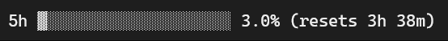
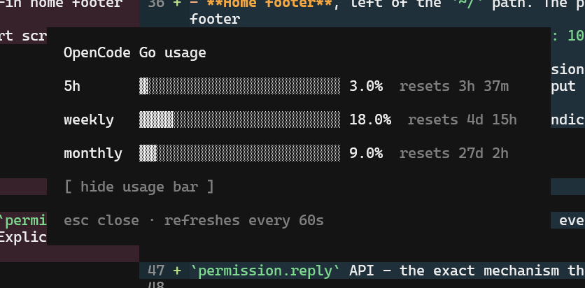

# opencode-usage-bar

[OpenCode Go](https://opencode.ai/docs/go/) usage bars for the [opencode](https://opencode.ai) v2 TUI - a persistent bar next to the prompt in sessions, plus a `/limit` popup with all three windows. Read-only; talks directly to the official usage API, never sends LLM prompts.

<div align="center">


<br />


<br />

<a href="https://www.buymeacoffee.com/leogimpel"></a>

</div>

> [!IMPORTANT]
> For opencode **1.x**, visit the [`OpenCode-v1` branch](https://github.com/Leogimp/opencode-usage-bar/tree/OpenCode-v1) - the last version built for the V1 TUI plugin API.

## Install

```sh
opencode plugin add @leo.gimp/opencode-usage-bar
```

That installs the package and adds it to `~/.config/opencode/cli.json` (the V2 terminal settings file). Quit and restart opencode afterwards - CLI plugin config is read at startup.

Requires opencode **v2**. For opencode 1.x, use the [`OpenCode-v1` branch](https://github.com/Leogimp/opencode-usage-bar/tree/OpenCode-v1).

To uninstall:

```sh
opencode plugin remove @leo.gimp/opencode-usage-bar
```

### Installing from a local checkout

If you prefer running straight from a clone, `npm run install-plugin` copies the sources to `~/.config/opencode/usage-bar/` and adds that path to `cli.json`:

```sh
npm install
npm run install-plugin
```

This is an explicit opt-in step, never an automatic one. Useful flags: `--dry-run` to preview every change, `--no-config` to copy the files without touching `cli.json`, `--config-dir DIR` to target a different opencode config directory. Any config file it changes is backed up alongside as `<file>.opencode-usage-bar.bak`, and it refuses to rewrite a config it cannot parse.

The renderer libraries (`solid-js`, `@opentui/core`, `@opentui/solid`) are peer dependencies supplied by the opencode host, so neither install path copies them. A second copy would break rendering: OpenTUI's reconciler keys off module identity, so JSX compiled against a different copy than the one rendering it produces nothing at all.

## Features

### Session usage bar

A full usage bar rendered on the right side of the prompt hint row (the same row as
`agent · model · provider · effort`), inside active sessions:

- Percent used, one decimal (`xx.x%`), 20-character `▓/░` bar, reset countdown (`4h 10m`, `3d 4h`, …)
- Refreshes automatically every **60 seconds** (with in-flight request deduplication and a 60s response cache)
- **Adaptive sizing** - mirrors opencode's own session layout (sidebar width, prompt padding)
  and terminal size, re-evaluated live on window resize:

  | Space available | Display |
  |---|---|
  | Plenty | full bar + percent + reset timer |
  | Tight | compact form `5h ▓▓░░░░░░ 11.0%` (no timer) |
  | Not enough | hidden - it never wraps or overlaps the prompt hints |

- Only shown once you are inside a session, not on the home or fresh-session screen
- Shows a dimmed `5h (unavailable)` if the request fails instead of silently disappearing



### `/limit` popup

Type `/limit` (or `ctrl+p` → *Usage limits*) for a popup with all three OpenCode Go windows -
rolling 5h, weekly, and monthly - each with a bar, percent used, and reset timer:

- Fetches **fresh** data every time it opens (bypasses the 60s cache)
- Reset timers keep ticking while the popup is open (30s tick)
- Hosted dialog panel, centered over the session; close with `esc`
- Footer shows the last four characters of the API key in use (`····xxxx`), so you can tell
  which account is displayed when several are connected
- `[ hide usage bar ]` toggle below the windows - hides or shows the session prompt bar,
  persisted across restarts in plugin storage (a pre-V2 `~/.config/opencode/usage-bar.json`
  preference is migrated automatically on first run)



### Data source

Reads the official OpenCode Go quota endpoint:

```
GET https://opencode.ai/zen/go/v1/usage
Authorization: Bearer <opencode-go key>
```

returning the rolling (5h), weekly, and monthly windows with percent used and reset times.
The plugin is read-only - it never sends prompts, session data, or anything else to the LLM.

## Options

Passed as the `options` object of the plugin entry in `cli.json`:

| Option | Default | Description |
|---|---|---|
| `left_reserve` | `44` | Columns reserved for the left prompt hints. Increase if the bar hides too late. |
| `sidebar_width` | `42` | Columns reserved for the session sidebar. Set `0` if you keep it hidden (e.g. `session.sidebar: "hide"` in `cli.json`). |
| `padding` | `6` | Prompt box inner padding subtracted from the available width. |

```json
{
  "$schema": "https://opencode.ai/v2/cli.json",
  "plugins": [
    {
      "package": "@leo.gimp/opencode-usage-bar",
      "options": { "left_reserve": 60 }
    }
  ]
}
```

## Notes

- Without an OpenCode Go key the plugin shows no bar - only the `/limit` command stays registered as a no-op.
- Key resolution (first match wins): `OPENCODE_GO_API_KEY` env → the **active** OpenCode Go credential in opencode's credential store (`~/.local/share/opencode/opencode.db`) → the legacy `opencode-go` entry in `~/.local/share/opencode/auth.json`. When several accounts are connected, the account actually in use is followed: switching accounts (`/connect`, credential activation) re-resolves the key via `credential.switched` events and refreshes usage immediately - no restart needed.
- The package ships its TypeScript sources unbuilt, which is the documented shape for an opencode CLI plugin: the Bun host transpiles them on load. There is no `dist/` and no build step.

## Local development

There is no build step - edit `src/` and restart opencode. To run from a checkout, point opencode at it directly in `~/.config/opencode/cli.json`:

```json
{
  "$schema": "https://opencode.ai/v2/cli.json",
  "plugins": ["C:\\path\\to\\opencode-usage-bar"]
}
```

The host transpiles the TypeScript on load, so a reload picks up source edits without any build step in between.

## Requirements

- opencode **v2** (uses the V2 CLI plugin slot API, `@opencode/plugin/tui`). Not compatible with opencode 1.x.
- An OpenCode Go subscription

## License

MIT
